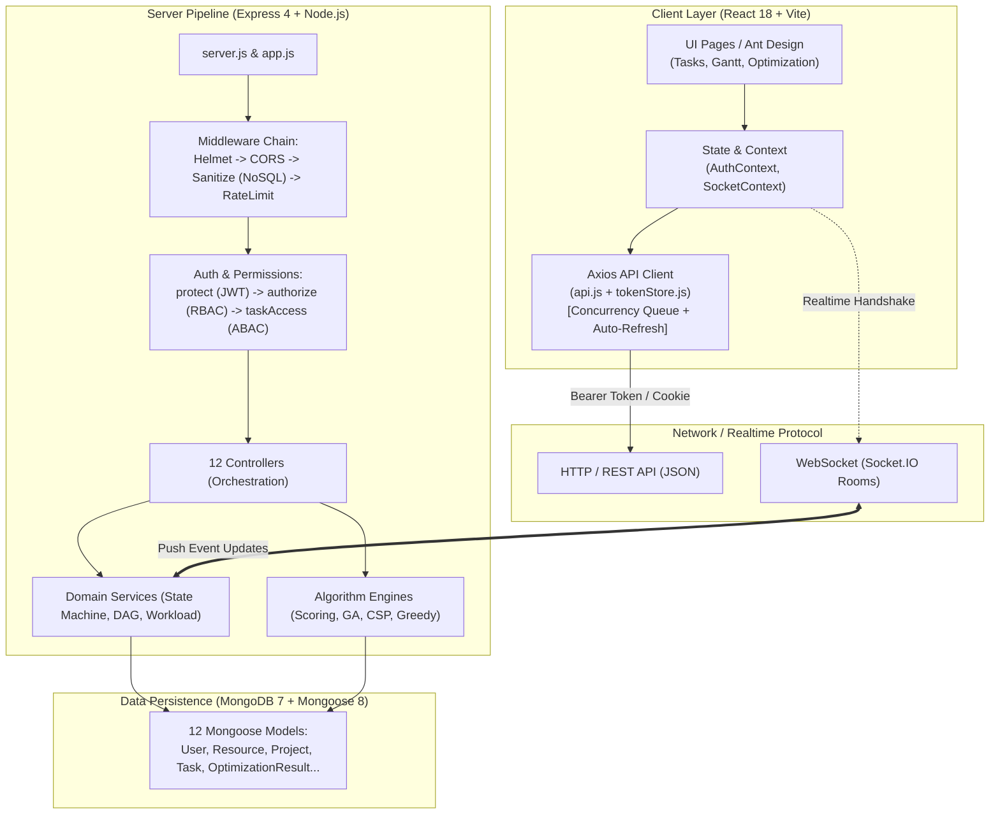
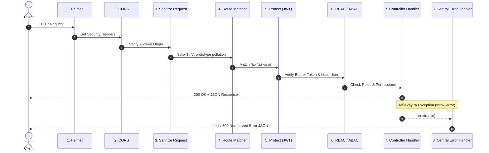
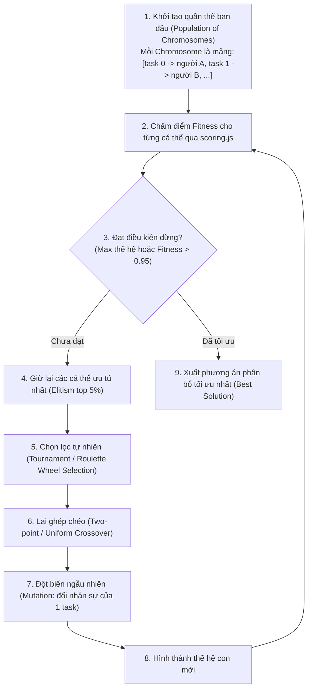

# 🗺️ CẨM NANG ĐỌC HIỂU & LÀM CHỦ CODEBASE: TỪ VIBE CODING ĐẾN SOFTWARE ENGINEER ĐÍCH THỰC

> **Dành riêng cho bạn** — Người đang cảm thấy "bị cụt tay" khi nhìn vào hàng chục file code do AI hỗ trợ sinh ra.
> 
> *Mục tiêu tối thượng:* Sau khi hoàn thành cẩm nang này theo đúng lộ trình, bạn có thể tự tin mở bất kỳ file nào trong hệ thống **Resource Allocation Optimization (RAO)**, giải thích được từng dòng code cho người khác, hiểu thấu luồng dữ liệu toàn trình, và quan trọng nhất: **tự tay code lại được toàn bộ kiến trúc lõi mà không cần dựa dẫm vào AI**.

---

## 🧭 LỜI MỞ ĐẦU: HIỂU VỀ "CƠN NGHIỆN VIBE CODE" & CÁCH LẤY LẠI ĐÔI TAY

### 1. Tại sao bạn cảm thấy "bị cụt tay"?
Khi bạn "vibe code", bộ não của bạn hoạt động ở chế độ **Reviewer lỏng lẻo** thay vì **Architect/Builder**:
- Bạn đưa ra ý tưởng $\rightarrow$ AI sinh ra 200 dòng code.
- Bạn paste vào $\rightarrow$ chạy thử thấy xanh đèn $\rightarrow$ cảm giác hưng phấn (dopamine hit).
- Sau 20 tính năng, dự án trở thành một khối hộp đen (Black Box). Bạn biết *cái gì* đang chạy, nhưng không nắm được *tại sao* nó chạy, *dữ liệu biến đổi* qua những hàm nào, và *nếu sập* thì sửa từ đâu.

### 2. Phương pháp "Giải phẫu & Tái tạo" (Reverse Engineering & Reconstruction)
Để lấy lại đôi tay, bạn không đọc code như đọc tiểu thuyết. Bạn sẽ áp dụng quy tắc 3 bước:
1. **Trace (Lần vết):** Đi theo luồng dữ liệu từ lúc người dùng ấn nút $\rightarrow$ mạng $\rightarrow$ server $\rightarrow$ cơ sở dữ liệu $\rightarrow$ quay lại UI.
2. **Deconstruct (Mổ xẻ):** Đặt câu hỏi *"Nếu không viết thế này thì hậu quả gì xảy ra? Bẫy (gotchas) ở đây là gì?"*.
3. **Rebuild (Tái lập):** Đóng AI lại, mở một file scratch trắng tinh, tự tay viết lại hàm đó bằng chính tư duy của mình.

---

## 🏛️ BẢN ĐỒ TỔNG QUAN HỆ THỐNG (SYSTEM TOPOLOGY)

Trước khi đọc từng file, hãy in bức tranh toàn cảnh này vào tâm trí:



---

## 📚 LỘ TRÌNH ĐỌC TUẦN TỰ TỪNG FILE (THE 7-PHASE ROADMAP)

Đừng đọc nhảy cóc! Hãy đọc theo đúng 7 chặng sau. Mỗi chặng giải quyết một tầng nhận thức.

| Chặng | Tên Chặng | File cần đọc theo thứ tự | Mục tiêu đạt được |
|:---:|---|---|---|
| **1** | **Hợp đồng dữ liệu** *(Data Contracts)* | 1. `server/src/models/User.js`<br/>2. `server/src/models/Resource.js`<br/>3. `server/src/models/Project.js`<br/>4. `server/src/models/Task.js`<br/>5. `server/src/models/OptimizationResult.js`<br/>6. `server/src/models/RefreshToken.js` | Nắm rõ thực thể, quan hệ 1-N, N-N, các trường virtual, index và ràng buộc nghiệp vụ. |
| **2** | **Cửa ngõ & Bộ lọc** *(Server Gateway)* | 1. `server/server.js`<br/>2. `server/app.js`<br/>3. `server/src/middleware/sanitize.js`<br/>4. `server/src/middleware/auth.js`<br/>5. `server/src/middleware/error.js` | Hiểu vòng đời của 1 HTTP Request, cơ chế phòng thủ NoSQL injection, giải mã JWT và 3 tầng phân quyền. |
| **3** | **Xương sống nghiệp vụ** *(Domain Logic)* | 1. `server/src/services/taskStatus.service.js`<br/>2. `server/src/services/taskDependency.service.js`<br/>3. `server/src/middleware/taskAccess.js`<br/>4. `server/src/controllers/task.controller.js`<br/>5. `server/src/services/workload.service.js` | Nắm vững State Machine của Task, đồ thị phụ thuộc DAG tránh lặp vòng, ma trận quyền theo đối tượng (ABAC). |
| **4** | **Bộ não Thuật toán** *(Optimization Core)* | 1. `server/src/algorithms/scoring.js`<br/>2. `server/src/algorithms/greedy/GreedyAllocator.js`<br/>3. `server/src/algorithms/csp/CSPSolver.js`<br/>4. `server/src/algorithms/genetic/GeneticAlgorithm.js`<br/>5. `server/src/controllers/optimization.controller.js` | Hiểu thấu toán đa mục tiêu (Multi-objective fitness), thuật toán thỏa mãn ràng buộc (CSP AC-3) và thuật toán di truyền (GA). |
| **5** | **Thời gian thực** *(Realtime WebSockets)* | 1. `server/src/services/socket.service.js`<br/>2. `client/src/context/SocketContext.jsx` | Hiểu cơ chế phân phòng (`socket.join('user:id')`), cơ chế phát thông điệp sau khi DB commit. |
| **6** | **Hạ tầng Frontend** *(Client Architecture)* | 1. `client/src/services/tokenStore.js`<br/>2. `client/src/services/api.js`<br/>3. `client/src/context/AuthContext.jsx`<br/>4. `client/src/components/common/ProtectedRoute.jsx` | Hiểu kỹ thuật lưu token trong RAM, Axios Interceptor với hàng đợi chống Refresh Token Storm kinh điển. |
| **7** | **Giao diện & Tương tác** *(UI Orchestration)* | 1. `client/src/pages/tasks/Tasks.jsx`<br/>2. `client/src/pages/tasks/components/TaskKanbanView.jsx`<br/>3. `client/src/utils/gantt.js`<br/>4. `client/src/pages/optimization/Optimization.jsx` | Thấy dữ liệu chảy từ hook React $\rightarrow$ biến đổi Kanban $\rightarrow$ tính toán đường găng Critical Path (CPM) trên biểu đồ Gantt. |

---

## 🔬 GIẢI PHẪU CHI TIẾT TỪNG CHẶNG VÀ TỪNG ĐOẠN CODE KINH ĐIỂN

---

### CHẶNG 1: HỢP ĐỒNG DỮ LIỆU (MODELS)

Khi mở một dự án backend, **luôn luôn đọc Model trước**. Model là bản thiết kế của thế giới thực trong code. Nếu không biết dữ liệu có hình thù gì, bạn sẽ không thể hiểu controller đang làm gì.

#### 1. File: `server/src/models/User.js` vs `Resource.js`
* **Vấn đề cốt lõi:** Tại sao lại tách `User` và `Resource` thành 2 collection riêng biệt?
* **Bản chất nghiệp vụ:**
  - `User`: Là **tài khoản đăng nhập** (Identity & Auth) gồm `email`, `password`, `role` (admin, project_manager, member), `appPermissions`.
  - `Resource`: Là **năng lực nhân sự** (Workforce & Capacity) gồm `skills` (tên, level), `hourlyRate`, `maxCapacity` (40h/tuần), `fte` (Full-time equivalent: 1.0, 0.5), `currentWorkload`.
  - Một `User` có thể liên kết với một `Resource` qua trường `resource: { type: ObjectId, ref: 'Resource' }`. Nhưng trong bài toán tối ưu hóa, thuật toán chỉ quan tâm đến `Resource` chứ không cần biết mật khẩu hay token của họ!

#### 2. File: `server/src/models/Task.js`
Hãy mở file này và xem dòng 13–31 và 209–248:

```javascript
// Trích từ server/src/models/Task.js
const dependencySchema = new mongoose.Schema(
  {
    task: { type: mongoose.Schema.Types.ObjectId, ref: 'Task', required: true },
    type: { type: String, enum: DEPENDENCY_TYPES, default: DEFAULT_DEPENDENCY_TYPE },
  },
  { _id: false } // 👈 TẠI SAO LẠI CÓ _id: false?
);
```

> **Hỏi:** Tại sao lại đặt `{ _id: false }` ở Subdocument này?
> 
> **Đáp:** Mặc định Mongoose tự sinh một `_id` mới cho mỗi phần tử trong mảng. Nhưng một quan hệ phụ thuộc công việc (Task A phụ thuộc Task B loại Finish-to-Start) chỉ là một cặp giá trị thuần túy, không phải một thực thể độc lập cần định danh. Đặt `_id: false` giúp:
> 1. Tiết kiệm dung lượng BSON trong MongoDB.
> 2. So sánh 2 mảng phụ thuộc dễ dàng mà không bị lệch do `_id` ngẫu nhiên sinh ra.

Tiếp theo, hãy nhìn vào cặp trường quan trọng:
```javascript
completedAt: { type: Date, default: null },
reviewedAt: { type: Date, default: null },
```
> **Triết lý thiết kế:** Tại sao có cả `completedAt` và `reviewedAt`?
> Nếu nhân viên ấn "Hoàn thành" lúc 17:00 ngày thứ Sáu (đúng hạn), nhưng thứ Hai tuần sau Sếp mới vào duyệt (Approve) chuyển sang `done`, thì hệ thống tính nhân viên đúng hạn hay trễ hạn?
> Codebase này ghi rõ: **`completedAt` là nguồn sự thật duy nhất** để tính KPI nhân viên. Người làm không phải chịu tội cho việc người đánh giá duyệt chậm! Đó chính là tư duy phân tích nghiệp vụ thực tế.

---

### CHẶNG 2: CỬA NGÕ HTTP & BỘ LỌC BẢO VỆ (MIDDLEWARE PIPELINE)

Hãy mở `server/app.js` và quan sát thứ tự đăng ký middleware:



#### File: `server/src/middleware/sanitize.js`
Đây là một trong những file xuất sắc nhất để học về bảo mật Backend:

```javascript
// Trích từ server/src/middleware/sanitize.js
const FORBIDDEN_KEYS = new Set(['__proto__', 'constructor', 'prototype']);

function sanitizeValue(value) {
  if (!value || typeof value !== 'object') return value;
  if (Array.isArray(value)) return value.map(sanitizeValue);

  const clean = {};
  for (const [key, val] of Object.entries(value)) {
    // 1. Chặn Prototype Pollution
    if (FORBIDDEN_KEYS.has(key)) continue;
    // 2. Chặn NoSQL Injection (Toán tử MongoDB như $gt, $ne, $where...)
    if (key.startsWith('$') || key.includes('.')) continue;

    clean[key] = sanitizeValue(val);
  }
  return clean;
}
```

> **Bản chất nguy hiểm:** Trong MongoDB, nếu người dùng gửi JSON payload:
> `{"email": "admin@rao.com", "password": {"$ne": "123"}}`
> Nếu không sanitize, câu lệnh `User.findOne({ email, password })` sẽ tìm user có email là admin và password **không bằng** "123" $\rightarrow$ Hacker đăng nhập thành công vào tài khoản Admin mà không cần mật khẩu!
> Nhờ hàm `sanitizeRequest` chạy trước mọi controller, toàn bộ toán tử có dấu `$` bị gọt sạch ở cửa ngõ.

#### File: `server/src/middleware/auth.js`
Hệ thống sử dụng **3 lớp lọc quyền** nối tiếp nhau:
1. `protect`: Đọc header `Authorization: Bearer <token>`, dùng `jwt.verify()` giải mã lấy `userId`, truy vấn DB nạp thông tin `req.user`.
2. `authorize('admin', 'project_manager')`: Kiểm tra vai trò tổng thể (RBAC).
3. `requireAppPermission('tasks')`: Kiểm tra ma trận quyền chi tiết (`none` < `view` < `manage`). Tự động so khớp method: nếu là `GET`/`HEAD` thì chỉ cần quyền `view`, nếu là `POST`/`PUT`/`DELETE` thì ép buộc quyền `manage`.

---

### CHẶNG 3: NGHIỆP VỤ CỐT LÕI & STATE MACHINE (SERVICES & CONTROLLERS)

#### 1. File: `server/src/services/taskStatus.service.js`
* **Vấn đề của Vibe Coder:** Cho phép Client gửi `PATCH /tasks/:id/status` với bất kỳ status nào, server nhận sao lưu vậy.
* **Hậu quả:** Task đang ở trạng thái `failed` (thất bại) lại bị ai đó chuyển ngược về `done` (hoàn thành), làm sai lệch toàn bộ báo cáo dự án.
* **Cách giải quyết chuẩn (Finite State Machine):**
  File này là một **Pure Function** (hàm thuần khiết, không chạm database):

```javascript
// Trích từ server/src/services/taskStatus.service.js
function validateStatusTransition({ currentStatus, nextStatus, project, failureReason, isReviewer }) {
  if (!TASK_STATUSES.includes(nextStatus)) {
    return { valid: false, message: 'Trạng thái công việc không hợp lệ' };
  }

  // Ràng buộc 1: Chuyển sang "failed" bắt buộc phải có cấu hình bật + có lý do
  if (nextStatus === 'failed') {
    if (!project?.failureConfig?.enabled) {
      return { valid: false, message: 'Dự án chưa bật tính năng đánh dấu thất bại' };
    }
    if (currentStatus === 'review') {
      return { valid: false, message: 'Không thể đánh dấu Thất bại khi đang Chờ đánh giá' };
    }
    if (!failureReason?.trim()) {
      return { valid: false, message: 'Cần nhập lý do thất bại' };
    }
  }

  // Ràng buộc 2: Chuyển sang "done" khi dự án có bật Review thì nhân viên không tự chuyển được
  if (nextStatus === 'done' && project?.reviewConfig?.enabled && !isReviewer) {
    return { valid: false, message: 'Chỉ người đánh giá mới có quyền duyệt sang Hoàn thành' };
  }

  return { valid: true };
}
```

> **Bài học kiến trúc:** Tách logic kiểm tra trạng thái thành hàm thuần riêng (`service`) giúp:
> - Controller rất ngắn gọn và sạch sẽ.
> - Viết Unit Test siêu dễ (chỉ cần truyền input object vào và `assert.equal(valid, true/false)` mà không cần mock Database hay tạo socket giả).

#### 2. File: `server/src/services/taskDependency.service.js` (Phát hiện chu trình DAG)
Công việc A phụ thuộc B, B phụ thuộc C, C lại phụ thuộc A $\rightarrow$ Xảy ra **Deadlock (vòng lặp luẩn quẩn)** khiến không việc nào có thể bắt đầu.
File này dùng thuật toán duyệt đồ thị **DFS (Depth-First Search)** để phát hiện chu trình trước khi lưu vào MongoDB:

```javascript
// Nếu thêm cạnh (taskId -> dependsOnTaskId) mà từ dependsOnTaskId có đường đi tới taskId
// ==> Tức là tạo thành chu trình kín => BẬP LỖI NGAY LẬP TỨC!
```

---

### CHẶNG 4: BỘ NÃO THUẬT TOÁN TỐI ƯU HÓA (ALGORITHMS)

Đây là "viên ngọc quý" của toàn bộ dự án này. Hãy đọc thật kỹ!

#### 1. File: `server/src/algorithms/scoring.js`
Trước khi tối ưu, máy tính phải biết thế nào là một phương án "Tốt" hay "Xấu". Đó là **Hàm mục tiêu (Fitness Function)**.

Công thức chấm điểm là sự kết hợp có trọng số của 4 tiêu chí:

$$\text{Fitness} = w_1 \cdot \text{SkillMatch} + w_2 \cdot \text{WorkloadBalance} + w_3 \cdot \text{CostEfficiency} + w_4 \cdot \text{CapacitySafety}$$

```javascript
// Trích từ server/src/algorithms/scoring.js
const DEFAULT_WEIGHTS = {
  workloadBalance: 0.30, // Cân bằng tải giữa các nhân sự
  skillMatch: 0.35,      // Trình độ nhân sự khớp với yêu cầu của task
  cost: 0.15,            // Chi phí thuê/lương nhân sự là thấp nhất
  overallocation: 0.20,  // Không ai bị giao quá 40h/tuần
};
```

* **Cách tính SkillMatch:**
  Nếu task đòi kỹ năng React level 3, nhân sự có React level 4 $\rightarrow$ điểm là $\min(4, 3) / 3 = 1.0$ (thỏa mãn 100%). Nếu nhân sự chỉ có level 1 $\rightarrow$ điểm là $1 / 3 = 0.33$.
* **Cách tính WorkloadBalance:**
  Sử dụng công thức tính độ lệch chuẩn (Standard Deviation) hoặc phương sai của số giờ làm giữa các nhân sự. Độ lệch càng nhỏ $\rightarrow$ công việc chia càng đều $\rightarrow$ điểm càng cao!

#### 2. File: `server/src/algorithms/genetic/GeneticAlgorithm.js`
Thuật toán Di truyền giải quyết bài toán theo cơ chế tiến hóa của Darwin:



> **Cách biểu diễn Chromosome (Gen):**
> Một mảng số nguyên đơn giản: `[2, 0, 1, 2, 4]`
> Nghĩa là:
> - Task 0 gán cho Resource thứ 2
> - Task 1 gán cho Resource thứ 0
> - Task 2 gán cho Resource thứ 1...
> Nhờ cách mã hóa dạng mảng chỉ số gọn nhẹ này, các phép tính Lai ghép (Crossover) và Đột biến (Mutation) diễn ra với tốc độ cực nhanh trong bộ nhớ RAM!

#### 3. File: `server/src/algorithms/csp/CSPSolver.js`
Khác với Genetic Algorithm (chấp nhận lời giải xấp xỉ), **CSP (Constraint Satisfaction Problem)** là thuật toán toán học chính xác:
- **Biến (Variables):** Danh sách các công việc $T_1, T_2, \dots, T_n$.
- **Miền giá trị (Domains):** Tập hợp nhân sự có thể làm công việc đó.
- **Ràng buộc cứng (Hard Constraints):**
  - $H_1$: Không ai được làm vượt quá tổng giờ trong tuần (Capacity).
  - $H_2$: Nhân sự phải có đủ các skill yêu cầu (Skill check).
  - $H_3$: Không bị trùng lịch nghỉ phép (Availability).
  - $H_4$: Hai việc phụ thuộc nhau, cùng khoảng thời gian thì không giao cho cùng một người.
- **Kỹ thuật tối ưu CSP trong file:**
  - **Lọc miền trước (Forward Checking):** Loại ngay nhân sự thiếu skill ra khỏi miền giá trị của task trước khi duyệt.
  - **MRV Heuristic (Minimum Remaining Values):** Luôn ưu tiên chọn xếp việc khó nhất trước (việc có ít nhân sự làm được nhất).
  - **Backtracking Search:** Duyệt cây đệ quy, nếu đi vào ngõ cụt thì tự động quay lui (backtrack).

---

### CHẶNG 5 & 6: THỜI GIAN THỰC & BẢO MẬT TOKEN PHÍA FRONTEND

#### 1. File: `client/src/services/tokenStore.js` & `api.js`
Đây là mẫu thiết kế (Design Pattern) đẳng cấp doanh nghiệp: **In-Memory Access Token + HttpOnly Cookie Refresh Token + Concurrency Waiter Queue**.

Hãy trả lời câu hỏi: *Tại sao không lưu Access Token trong `localStorage`?*
> **Nguy cơ XSS:** Nếu trang web bị chèn mã độc (XSS), hacker chỉ cần gọi `localStorage.getItem('token')` là lấy cắp được phiên đăng nhập của người dùng vĩnh viễn!
> **Giải pháp của hệ thống:**
> - Access Token được lưu trong một biến Javascript trong RAM (`tokenStore.js`). Đóng tab là biến tự hủy $\rightarrow$ Miễn nhiễm 100% với XSS đọc trộm lưu trữ.
> - Refresh Token được lưu trong `HttpOnly Cookie`. Javascript không thể đọc được cookie này.
> - Mỗi khi mở lại web, ứng dụng tự động gọi `/api/auth/refresh` để lấy lại Access Token vào RAM.

#### 2. Kỹ thuật "Chống bão Refresh Token" (Thundering Herd / Race Condition)
Hãy mở `client/src/services/api.js` dòng 46–116:

```javascript
// Trích từ client/src/services/api.js
let refreshing = null; // Promise giữ tiến trình refresh đang chạy
const waiters = [];    // Mảng hàng đợi chứa các request bị 401 đang chờ

api.interceptors.response.use(
  (response) => response,
  async (error) => {
    const original = error.config;
    const status = error.response?.status;

    if (status !== 401 || original._retried) {
      return Promise.reject(error);
    }

    original._retried = true; // Đánh dấu để không lặp vô tận

    // NẾU CHƯA CÓ AI REFRESH THÌ MÌNH LÀ NGƯỜI ĐẦU TIÊN ĐI LÀM MỚI
    if (!refreshing) {
      refreshing = runRefresh()
        .then((token) => {
          setToken(token);
          // Đánh thức tất cả các request đang xếp hàng chờ
          while (waiters.length) waiters.shift()(token, null);
          return token;
        })
        .catch((err) => {
          while (waiters.length) waiters.shift()(null, err);
          clearSessionAndRedirect();
        })
        .finally(() => {
          refreshing = null; // Hoàn tất lượt làm mới
        });
    }

    // CÁC REQUEST ĐẾN SAU SẼ ĐƯỢC ĐƯA VÀO HÀNG ĐỢI (WAITERS QUEUE)
    return new Promise((resolve, reject) => {
      waiters.push((token, err) => {
        if (err || !token) return reject(err || error);
        // Gắn token mới và bắn lại request ban đầu!
        original.headers.Authorization = `Bearer ${token}`;
        resolve(api(original));
      });
    });
  }
);
```

> **Tại sao đoạn code này lại "cứu mạng" hệ thống?**
> Giả sử khi người dùng mở Dashboard, React đồng thời gửi 5 request song song: lấy danh sách task, lấy thông báo, lấy KPI, lấy dự án, lấy lịch sử.
> Sau 15 phút, Access Token hết hạn. **Cả 5 request cùng nhận mã lỗi 401 Unauthorized cùng một thời điểm!**
> - Nếu không có hàng đợi: Cả 5 request sẽ đồng loạt gọi `POST /api/auth/refresh`. Do server kích hoạt cơ chế **Token Rotation** (Refresh token chỉ dùng được 1 lần, lần thứ hai dùng lại sẽ bị coi là token bị ăn cắp), request thứ 2 gửi lên sẽ làm lộ token cũ $\rightarrow$ Server kích hoạt báo động bảo mật, hủy toàn bộ phiên và đá người dùng ra màn hình Login ngay lập tức!
> - Nhờ cơ chế `waiters queue`: Chỉ đúng 1 request đầu tiên được phép gọi `runRefresh()`. 4 request còn lại kiên nhẫn xếp hàng trong `waiters`. Khi token mới về, cả 4 request tự động cầm chìa khóa mới và bay tiếp đến đích mà người dùng không hề nhận ra sự gián đoạn!

---

### CHẶNG 7: GIAO DIỆN & TƯƠNG TÁC (REACT & GANTT CPM)

#### File: `client/src/utils/gantt.js` (Phương pháp đường găng - Critical Path Method CPM)
Tại sao một số công việc trên biểu đồ Gantt lại có màu đỏ rực?
Đó là các công việc nằm trên **Đường găng (Critical Path)**:
- Những công việc mà nếu nó bị trễ dù chỉ 1 ngày, toàn bộ ngày kết thúc của cả dự án sẽ bị trễ tương ứng.
- File `gantt.js` tính toán qua 2 bước:
  1. **Forward Pass (Lướt tiến):** Tính thời điểm sớm nhất có thể bắt đầu ($ES$) và kết thúc ($EF$).
  2. **Backward Pass (Lướt lùi):** Tính thời điểm trễ nhất có thể bắt đầu ($LS$) và kết thúc ($LF$) mà không làm chậm dự án.
  3. **Độ chùng (Slack/Float):** $Slack = LS - ES$. Nếu $Slack = 0$, công việc đó bắt buộc phải nằm trên đường găng (Critical Path)!

---

## 🚀 KỊCH BẢN THỰC THI TOÀN TRÌNH (END-TO-END DATA FLOW TRACES)

Hãy tự nhắm mắt lại và hình dung bạn đang theo dõi một gói dữ liệu chạy qua từng ngõ ngách:

### Luồng 1: Người dùng chuyển trạng thái Task trên giao diện Kanban
1. **User Action:** Người dùng kéo thẻ Task từ cột "Đang làm" (in_progress) thả sang cột "Chờ duyệt" (review).
2. **React Event:** Hàm `handleDragEnd` trong `TaskKanbanView.jsx` bắt sự kiện, cập nhật ngay UI tạm thời (Optimistic UI update) để tạo cảm giác mượt mà.
3. **API Call:** Gọi `taskService.updateStatus(taskId, 'review')` $\rightarrow$ đi qua `client/src/services/api.js`.
4. **Network:** Request HTTP `PATCH /api/tasks/:id/status` với Header `Authorization: Bearer <jwt>`.
5. **Server Gate:**
   - `helmet` kiểm tra header.
   - `cors` xác thực origin `http://localhost:5173`.
   - `sanitizeRequest` kiểm tra payload không chứa ký tự cấm.
   - `apiLimiter` đảm bảo không bị spam.
6. **Authentication & Authorization:**
   - `protect` middleware giải mã JWT token, tìm user trong DB, gán vào `req.user`.
   - `taskAccess` kiểm tra người dùng này có phải là Người thực hiện (Assignee) hoặc Quản lý của task này không.
7. **Business Logic Execution:**
   - `task.controller.js` gọi hàm `validateStatusTransition` trong `taskStatus.service.js`.
   - Hàm xác nhận: chuyển từ `in_progress` sang `review` là hoàn toàn hợp lệ.
   - `Task.findByIdAndUpdate` lưu trạng thái mới và gán `reviewRequestedAt = new Date()`.
   - `activityLog.service.js` tạo một bản ghi lịch sử: *"Nguyễn Văn A đã chuyển trạng thái sang Chờ duyệt"*.
8. **Realtime Broadcast:**
   - `socket.service.js` gọi `getIO().to('user:pmId').emit('task:status_changed', { taskId, status: 'review' })`.
   - Quản lý dự án dù đang ở màn hình khác cũng ngay lập tức thấy chuông thông báo đỏ lên mà không cần F5 trang web!
9. **Response:** Server trả về HTTP 200 `{ success: true, data: updatedTask }`.

---

## 🧠 10 KIẾN THỨC KỸ THUẬT QUAN TRỌNG NHẤT CẦN RÚT RA

Đây là 10 khái niệm "vàng" giúp bạn biến kiến thức của dự án này thành năng lực vĩnh viễn của chính mình:

1. **Clean Layered Architecture (Kiến trúc phân tầng sạch):**
   - Không bao giờ viết query Database trong Router.
   - Route $\rightarrow$ Middleware (Bảo vệ) $\rightarrow$ Controller (Điều phối) $\rightarrow$ Service (Nghiệp vụ thuần) $\rightarrow$ Model (Dữ liệu).
2. **Defense in Depth (Bảo vệ đa tầng):**
   - Bảo mật không phải là 1 bức tường mà là chuỗi mắt xích: Sanitize $\rightarrow$ Rate Limiter $\rightarrow$ JWT Authentication $\rightarrow$ Module RBAC $\rightarrow$ Object-level ABAC.
3. **Advanced Token Security:**
   - Phân biệt rạch ròi giữa Access Token (ngắn hạn 15p, lưu RAM) và Refresh Token (dài hạn 7 ngày, HttpOnly cookie, xoay vòng - rotation).
4. **Concurrency Race-Condition Handling:**
   - Sử dụng cơ chế hàng đợi (Queue array of callbacks) trong Axios Interceptor để xử lý bài toán nhiều request cùng hết hạn token một lúc.
5. **Finite State Machine (FSM):**
   - Quản lý vòng đời dữ liệu bằng máy trạng thái hữu hạn. Không để trạng thái nhảy tự do. Viết dưới dạng hàm thuần khiết để kiểm thử độc lập.
6. **Multi-Objective Optimization (Tối ưu hóa đa mục tiêu):**
   - Chuẩn hóa các đại lượng khác nhau (giờ làm, tiền tệ, kỹ năng 1-4) về cùng thang đo $0..1$ trước khi nhân với trọng số (Weighting sum model).
7. **AI & Heuristic Algorithms (Toán rời rạc & Trí tuệ nhân tạo):**
   - Hiểu sự khác biệt giữa thuật toán chính xác dựa trên ràng buộc cứng (CSP AC-3, MRV) và thuật toán xấp xỉ dựa trên tiến hóa sinh học (Genetic Algorithm).
8. **Graph Theory & Critical Path Method (Đồ thị & Đường găng):**
   - Ứng dụng cấu trúc đồ thị có hướng không chu trình (DAG) để phát hiện phụ thuộc chéo và thuật toán tính đường găng cho kế hoạch dự án.
9. **Event-Driven Realtime Architecture:**
   - Tách biệt kênh phát lệnh (HTTP REST) và kênh thông báo đồng bộ trạng thái (Socket.IO Rooms).
10. **Data Decoupling (Tách rời định danh và năng lực):**
    - Thiết kế phân tách giữa bảng Tài khoản (`User`) và bảng Hồ sơ năng lực (`Resource`) giúp hệ thống linh hoạt, dễ mở rộng và tăng tốc độ xử lý thuật toán.

---

## 🛠️ PHƯƠNG PHÁP LUYỆN TẬP ĐỂ "PHỤC HỒI ĐÔI TAY" (DELIBERATE PRACTICE)

Đừng chỉ đọc lý thuyết! Hãy dành ra 3 ngày để làm bài tập rèn luyện này:

### Bài tập 1: Tự viết lại hàm `sanitizeValue` (Mất 15 phút)
- Mở một file trống `test-sanitize.js`.
- Tự tay viết một hàm nhận vào một object lồng nhau (nested object) và xóa sạch các key có ký tự `$` hoặc key `__proto__`.
- Chạy thử bằng `node test-sanitize.js` với object mẫu: `{ name: "test", "$where": "malicious", nested: { "$gt": 0, ok: 1 } }`.

### Bài tập 2: Tự viết lại hàm `validateStatusTransition` (Mất 30 phút)
- Tự vẽ sơ đồ trạng thái công việc ra giấy (Todo $\rightarrow$ In Progress $\rightarrow$ Review $\rightarrow$ Done / Failed).
- Tự viết hàm kiểm tra xem từ trạng thái A sang B có được phép không, với các điều kiện ràng buộc.

### Bài tập 3: Tự viết thuật toán Genetic Algorithm đơn giản (Mất 2 tiếng)
- Cho 3 công việc với số giờ `[4, 8, 2]`.
- Cho 2 nhân viên.
- Hãy tự viết một đoạn code GA nhỏ: sinh ra 10 mảng ngẫu nhiên (ví dụ `[0, 1, 0]`), tính tổng giờ làm của 2 nhân viên, và tìm mảng nào chia đều giờ nhất!

---

> *"Lập trình viên giỏi không phải là người nhớ từng cú pháp của thư viện, mà là người hiểu rõ luồng dữ liệu di chuyển như thế nào và tại sao hệ thống lại được tổ chức theo cấu trúc đó. Khi bạn đã hiểu được kiến trúc và cái lý đằng sau từng dòng code, AI sẽ trở thành người trợ lý đắc lực của bạn, thay vì biến bạn thành con rối của nó."*
